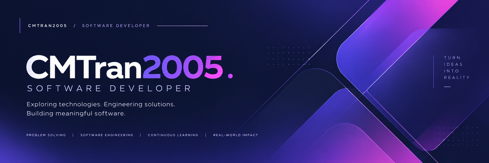
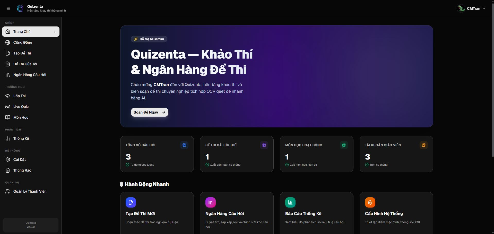
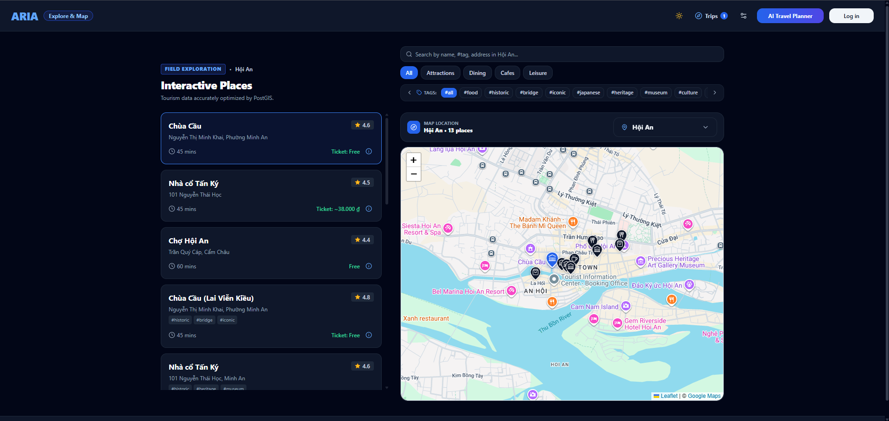
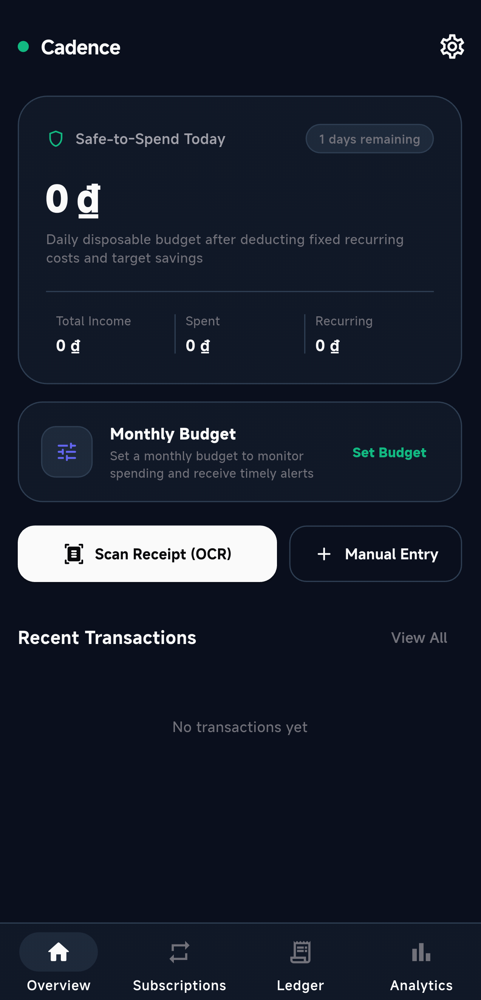

### Software Developer

**Exploring technologies. Engineering solutions. Building meaningful software.**

 &nbsp; 

---

## 01 / About

I am a software developer interested in understanding problems, exploring different areas of technology, and building software that creates practical value. Rather than defining myself by one framework or platform, I focus on engineering fundamentals and how different parts of a system work together.

> **My approach:** Learn deeply. Build thoughtfully. Improve continuously.

Tiếng Việt

Mình là một Software Developer yêu thích việc tìm hiểu vấn đề, khám phá nhiều lĩnh vực công nghệ và xây dựng phần mềm có giá trị thực tiễn. Thay vì giới hạn bản thân trong một framework hay nền tảng, mình tập trung vào nền tảng kỹ thuật và cách các thành phần trong hệ thống phối hợp với nhau.

**Cách tiếp cận:** Học có chiều sâu. Xây dựng có chủ đích. Liên tục cải thiện.

## 02 / Engineering Identity

| THINK CRITICALLY | DESIGN THOUGHTFULLY |
|:---|:---|
| Understand the problem before choosing a solution. | Favor clarity, maintainability and sound trade-offs. |
| **BUILD ITERATIVELY** | **EXPLORE BROADLY** |
| Learn through prototypes, testing and improvement. | Stay curious across software domains and technologies. |

**Areas of interest**

| Software Engineering | Application Development | Intelligent Systems | Data & Infrastructure |
|:---|:---|:---|:---|
| Algorithms, architecture, design principles | Web, mobile, APIs, product development | OCR, optimization, practical AI | Databases, cloud services, reliability |

These are areas of interest and exploration, not claims of equal expertise.

---

## 03 / Selected Work

A focused selection of projects spanning different problem spaces. Each one represents an opportunity to apply engineering thinking and learn from real implementation decisions.

### Quizenta — Smart Examination & Question Bank

**Problem & solution.** Creating and managing assessments becomes more demanding when questions include mathematical expressions and content that must be digitized. Quizenta brings question banks, exam authoring and online assessments into one education-focused workflow.

**Engineering highlights.** Explores Gemini-assisted OCR, mathematical input and rendering with MathLive and KaTeX, and application state management with Zustand.

     

 · 

### ARIA — Adaptive Route Intelligence Assistant

**Problem & solution.** Planning a trip involves balancing destinations, routes and changing constraints. ARIA explores adaptive itinerary planning supported by route optimization and geospatial data.

**Engineering highlights.** Applies OR-Tools to optimization problems, uses PostGIS-backed spatial data, and connects a Next.js interface with FastAPI services.

     

### Cadence — Personal Finance Management

**Problem & solution.** Personal spending is harder to understand when transactions, recurring expenses and budgets are tracked separately. Cadence brings these everyday finance workflows into a mobile application.

**Engineering highlights.** Combines Flutter and Dart with local SQLite storage, spending insights and on-device receipt text recognition using Google ML Kit.

   

Tiếng Việt — Tổng quan dự án

- **Quizenta:** Tập trung giải quyết bài toán tạo và quản lý đề thi có nội dung toán học. Điểm kỹ thuật nổi bật là OCR hỗ trợ bởi Gemini, nhập/hiển thị công thức với MathLive và KaTeX, cùng quản lý trạng thái ứng dụng bằng Zustand.
- **ARIA:** Khám phá bài toán xây dựng lịch trình du lịch linh hoạt và tối ưu tuyến đường. Kết hợp OR-Tools, dữ liệu không gian PostGIS và giao tiếp giữa Next.js với FastAPI.
- **Cadence:** Gom việc theo dõi giao dịch, chi phí định kỳ và ngân sách vào một ứng dụng di động. Kết hợp Flutter, lưu trữ SQLite và nhận dạng văn bản hóa đơn trên thiết bị bằng Google ML Kit.

---

## 04 / Technical Landscape

Technologies used or explored through projects; representative rather than exhaustive.

| CATEGORY | TOOLKIT |
|:---|:---|
| **Languages** |        |
| **Applications** |      |
| **Backend & Data** |        |
| **Tools & Practices** |      |

---

## 05 / Engineering Principles

**01 — Understand before implementing.** Solve the actual problem, not just the immediate prompt.

**02 — Prefer clarity over complexity.** Make software understandable and maintainable.

**03 — Design for change.** Keep structures flexible enough for evolving requirements.

**04 — Use tools with judgment.** AI can accelerate work; review, testing and accountability still matter.

**05 — Learn by building.** Practical work turns ideas into engineering experience.

Tiếng Việt — Nguyên tắc phát triển

1. Hiểu vấn đề trước khi triển khai.
2. Ưu tiên sự rõ ràng thay vì độ phức tạp không cần thiết.
3. Thiết kế để thích nghi với thay đổi.
4. Sử dụng AI và công cụ có đánh giá, kiểm thử và trách nhiệm.
5. Học thông qua việc xây dựng sản phẩm thực tế.

---

## 06 / Current Focus

| DIRECTION | WHAT I'M WORKING TOWARD |
|:---|:---|
| **Software Engineering** | Stronger fundamentals, architecture and maintainable systems |
| **Intelligent Applications** | Thoughtful integration of AI into useful software |
| **System Design** | Better understanding of reliable and scalable solutions |

Tiếng Việt — Định hướng hiện tại

Mình tiếp tục củng cố nền tảng kỹ thuật phần mềm, tìm hiểu cách tích hợp AI một cách phù hợp và rèn luyện tư duy thiết kế hệ thống thông qua các dự án thực tế.

---

## 07 / GitHub Insights

A concise snapshot of my public GitHub activity. Numbers provide context, not a complete measure of engineering ability.

 

**Most Used Languages**

<!-- OPTIONAL: WakaTime coding activity. To enable:
1. Sign up for WakaTime and connect an editor plugin.
2. Make 'Display code time publicly' and 'Display languages, editors, os, categories publicly' public in WakaTime settings.
3. Replace YOUR_WAKATIME_USERNAME with your actual WakaTime username.
4. Remove this HTML comment wrapper to show the card.

**Development Time — Last 7 Days**

-->

Tiếng Việt — Thống kê GitHub

Tổng quan hoạt động công khai trên GitHub. Các chỉ số mang tính tham khảo, không phản ánh toàn bộ năng lực hay chất lượng phần mềm.

---

## 08 / Connect & Collaborate

### Good software starts with meaningful conversations.

I enjoy exchanging ideas, learning from different perspectives, and connecting with people who care about building thoughtful software.

 &nbsp; 

Curious about a project or an idea? You can reach me through my GitHub profile.

Tiếng Việt

Mình luôn sẵn sàng trao đổi ý tưởng, học hỏi từ những góc nhìn mới và kết nối với những người yêu thích việc xây dựng phần mềm có giá trị.

 &nbsp; 

---

**Learn continuously. Build thoughtfully. Improve consistently.**

[github.com/CMTran2005](https://github.com/CMTran2005)

Indigo · Violet · Magenta — CMTran visual identity

